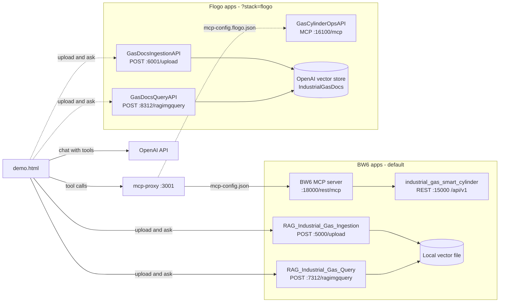
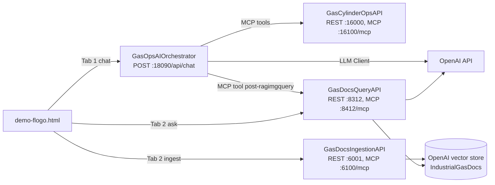

# Industrial Gas Smart Operations AI Demo - BW6 and Flogo

An AI assistant for a fictional industrial gas cylinder operation. One browser UI with two tabs:

1. **Smart Cylinder Operations** - an AI agent answers questions about cylinder stock by calling live cylinder tools over MCP (Model Context Protocol): `searchGasStock`, `getCylinderStatus`, `dispatchCylinder`.
2. **AI Document Assistant** - upload safety data sheets, SOPs and policies into a vector store, then ask questions (optionally with an image) and get answers with citations.

The sample ships the same use case twice: the original **TIBCO BusinessWorks 6 (BW6)** apps and a **TIBCO Flogo 2.x** modernization of them, plus an all-Flogo AI orchestrator. You can run the two stacks side by side, or run Flogo only.

| Run path | You need | UI |
|---|---|---|
| [Flogo only](#run---flogo-only) | The 4 Flogo apps | `demo-flogo.html` |
| [BW6 + Flogo side by side](#run---bw6--flogo-side-by-side) | The 3 BW6 apps, the Flogo apps, the Node.js `mcp-proxy` | `demo.html` (BW6), `demo.html?stack=flogo`, `demo-flogo.html` |

All data is fictional: the cylinder inventory is mock data inside the apps, and the files in `sample_docs/` are demo documents, not for operational use.

---

## Architecture

### BW6 + Flogo side by side

`demo.html` runs the chat agent in the browser: it calls the OpenAI API with the tool definitions, and runs each tool call through `mcp-proxy`, which bridges to an MCP server. `?stack=flogo` points the cylinder, upload and query endpoints at the Flogo apps; start the proxy with `mcp-config.flogo.json` to bridge to the Flogo MCP server instead of the BW6 one.



### Flogo only

`demo-flogo.html` sends chat messages to `GasOpsAIOrchestrator`, which runs the agent server-side with one LLM Client activity connected to two Flogo MCP servers. No OpenAI key in the browser, no Node.js proxy.



---

## Apps

### BW6 apps (`BW-Apps/`)

Each app is a BW6 module plus its `.application` project. Built with BusinessWorks 6.11 / 6.12; open them in Business Studio 6.12 HF4.

| App | Endpoint | What it does |
|---|---|---|
| `industrial_gas_smart_cylinder` | REST `http://localhost:15000/api/v1` (HTTP connector `api-v1.httpConnResource`); operations exposed as MCP tools through the BW6 MCP server, expected at `http://localhost:18000/rest/mcp` | `GET /cylinders/search?gasType=&location=`, `GET /cylinders/{id}`, `POST /cylinders/{id}/dispatch` over 4 mock cylinders. MCP tools `searchGasStock`, `getCylinderStatus`, `dispatchCylinder` |
| `RAG_Industrial_Gas_Ingestion` | `POST http://localhost:5000/upload` (multipart) | Saves each file, chunks it and ingests it into a local vector file with BW6 RAG activities |
| `RAG_Industrial_Gas_Query` | `POST http://localhost:7312/ragimgquery` (multipart `question` + optional `imageInput`) | Retrieves the relevant chunks and asks the LLM for an answer |

### Flogo apps (`Flogo-Apps/`)

Flogo 2.x apps (saved with Flogo 2.26.9). Each REST port is the BW6 port + 1000, except ingestion (see the note).

| App | REST | MCP server | What it does |
|---|---|---|---|
| `GasCylinderOpsAPI` | `:16000/api/v1` - same three operations as the BW6 app | `:16100/mcp` - tools `searchGasStock`, `getCylinderStatus`, `dispatchCylinder` | Same API and same mock data as the BW6 app. Search matches `gasType` and `location` exactly; dispatch returns an "In Transit" confirmation but does not change the data |
| `GasDocsIngestionAPI` | `POST :6001/upload` - multipart `files` plus a `fileNames` JSON list (the UI sends both) | `:6100/mcp` - tool `post-upload` | Saves the files to `DOCS_DIR`, finds or creates the OpenAI vector store `VECTOR_STORE_NAME` (`IndustrialGasDocs`), uploads each file and attaches it to the store |
| `GasDocsQueryAPI` | `POST :8312/ragimgquery` - multipart `question` + optional `imageInput` | `:8412/mcp` - tool `post-ragimgquery` | Text question: OpenAI vector-store search, then an LLM Client answer with inline citations and a Sources section. With images: Invoke REST to the OpenAI Chat Completions API (`OPENAI_CHAT_COMPLETIONS_URL`) |
| `GasOpsAIOrchestrator` | `POST :18090/api/chat` `{message, conversationId}` returns `{answer, conversationId}`; `GET :18090/api/health` | - (MCP client) | One Agentic AI LLM Client activity with two MCP server connections: `GasCylinderOps` (`http://localhost:16100/mcp`) and `GasDocs` (`http://localhost:8412/mcp`). In-memory conversation memory per `conversationId`; today's date is injected into the system prompt so it can flag expired certificates. Replaces the browser tool loop and `mcp-proxy` |

> **Why 6001, not 6000:** browsers refuse to call port 6000 (an X11 "unsafe port"), so the Flogo ingestion app listens on 6001.

---

## Folder layout

```text
Industrial_Gas_AI_Ops/
├── BW-Apps/                    3 BW6 modules + their .application projects
│   ├── industrial_gas_smart_cylinder[.application]
│   ├── RAG_Industrial_Gas_Ingestion[.application]
│   └── RAG_Industrial_Gas_Query[.application]
├── Flogo-Apps/                 GasCylinderOpsAPI, GasDocsIngestionAPI, GasDocsQueryAPI, GasOpsAIOrchestrator (.flogo)
├── mcp-proxy/                  Node.js HTTP/CORS bridge to an MCP server (port 3001), used by demo.html only
│   ├── server.js
│   ├── mcp-config.json         points at the BW6 MCP server (default)
│   └── mcp-config.flogo.json   points at the Flogo GasCylinderOpsAPI MCP server
├── sample_docs/                6 fictional documents to ingest
├── demo.html                   original UI: BW6 stack, or the Flogo apps with ?stack=flogo
└── demo-flogo.html             all-Flogo UI: chat goes to GasOpsAIOrchestrator
```

---

## Prerequisites

### Flogo only

- **VS Code + TIBCO Flogo extension 2.26.9 or later** - to open and design the apps. Download it, and `flogobuild`, from the [TIBCO downloads page](https://www.tibco.com/downloads/11810).
- **The repo's OpenAI user extension** (`extensions/openAI` at the repo root) - `GasDocsIngestionAPI` and `GasDocsQueryAPI` use its vector-store activities. To see them in the designer, register the folder in the VS Code setting **Flogo > Extensions: Local** (see [extensions/openAI/README.md](../../../../extensions/openAI/README.md)).
- **Flogo App Build CLI (`flogobuild`) 1.1.x + Go 1.25.7 or later** - to build the executables.
- **An OpenAI API key** with access to the Files, Vector Stores and Chat APIs, and a **tool-calling model** (default `gpt-5.5`; nano-class models drop tool calls). Image questions need a vision-capable model.
- A modern browser. No BW6, no Node.js.

### BW6 + Flogo side by side

Everything above, plus:

- **TIBCO BusinessWorks 6.12 HF4** (Business Studio or an AppNode) with the **AI/RAG** and **MCP** palettes, and the BW6 MCP server enabled.
- **Node.js 18+ and npm** - for `mcp-proxy` (it starts `npx mcp-remote`).
- The OpenAI key is also needed in the browser (`demo.html` calls the OpenAI API directly) and in the two BW6 `.ragResource` files.

---

## Run - Flogo only

### 1. Build the executables

Create two build contexts once (context names: letters, digits, `_`, `-`; no dots):

```bash
# For GasCylinderOpsAPI and GasOpsAIOrchestrator
flogobuild create-context -n flogo_std -v <path-to-flogo-vscode-extension.vsix>
# For GasDocsIngestionAPI and GasDocsQueryAPI (adds the repo's OpenAI user extension)
flogobuild create-context -n flogo_openai -v <path-to-flogo-vscode-extension.vsix> -u <repo-root>/extensions
```

Build from the `Flogo-Apps` folder. Use `-o ../bin` or an absolute output path:

```bash
cd Flogo-Apps
flogobuild build-exe -f GasCylinderOpsAPI.flogo   -c flogo_std    -o ../bin
flogobuild build-exe -f GasDocsIngestionAPI.flogo -c flogo_openai -o ../bin
flogobuild build-exe -f GasDocsQueryAPI.flogo     -c flogo_openai -o ../bin
flogobuild build-exe -f GasOpsAIOrchestrator.flogo -c flogo_std   -o ../bin
```

Add `-l <licence-file>` for a production-licensed build. Without a licence, builds on Windows and macOS are non-production and stop after 24 hours.

### 2. Start the apps

Start each app in its own terminal, **in this order**. The orchestrator connects to the MCP servers when it starts, so it must be last. Supply keys at run time: `FLOGO_APP_PROPS_ENV=auto` lets any app property be set from an environment variable of the same name.

Git Bash / Linux / macOS (drop `.exe` on Linux and macOS):

```bash
cd bin
./GasCylinderOpsAPI.exe
FLOGO_APP_PROPS_ENV=auto OPENAI_API_KEY=<your-openai-api-key> ./GasDocsIngestionAPI.exe
FLOGO_APP_PROPS_ENV=auto OPENAI_API_KEY=<your-openai-api-key> ./GasDocsQueryAPI.exe
FLOGO_APP_PROPS_ENV=auto LLM_API_KEY=<your-openai-api-key> ./GasOpsAIOrchestrator.exe
```

PowerShell (one window per app):

```powershell
$env:FLOGO_APP_PROPS_ENV='auto'; $env:OPENAI_API_KEY='<your-openai-api-key>'; .\GasDocsQueryAPI.exe
$env:FLOGO_APP_PROPS_ENV='auto'; $env:LLM_API_KEY='<your-openai-api-key>'; .\GasOpsAIOrchestrator.exe
```

`GasDocsIngestionAPI` writes uploaded files to `DOCS_DIR` (`gas_docs`, relative to the folder you start it from).

### 3. Open the UI

Open `demo-flogo.html` in a browser (double-click it; `file://` works). The header should show **All services online**. Then follow [Using the demo](#using-the-demo).

---

## Run - BW6 + Flogo side by side

### 1. Run the BW6 apps

1. Import the six projects under `BW-Apps/` into TIBCO Business Studio 6.12 HF4 (File > Import > Existing Studio Projects into Workspace), or deploy the three `.application` modules to an AppNode.
2. In Business Studio, open both RAG shared resources, set your OpenAI key and check the models and the vector file:
   - `BW-Apps/RAG_Industrial_Gas_Ingestion/Resources/rest_download/IngestRAGConfiguration.ragResource`
   - `BW-Apps/RAG_Industrial_Gas_Query/Resources/rag_image_query/RAGConfiguration.ragResource`

   Defaults: `openAIModelType="gpt-5.5"`, `embeddingOpenAIModelName="text-embedding-3-large"`, `embeddingStorageProvider="local"`, `localStorageFileLocation="C:\tmp\industrial_gas_demo\localvector.txt"`. Create the folder first (or change the path on macOS/Linux, e.g. `/tmp/industrial_gas_demo/localvector.txt`). Both apps must point at the same file. The ingestion process also writes the uploaded files under `C:\tmp\industrial_gas_demo`.
3. Enable the BW6 MCP server for the cylinder app (BW 6.12 with MCP support; JVM argument `-Dbw.enable.mcp.server=true`). This sample expects it at `http://localhost:18000/rest/mcp`.
4. Run the three apps: cylinder REST on **15000**, ingestion on **5000**, query on **7312**.

### 2. Run the Flogo apps

Build and start them as in [Run - Flogo only](#run---flogo-only). The Flogo ports do not clash with the BW6 ones, so both stacks run on one machine. `GasOpsAIOrchestrator` is needed only for `demo-flogo.html`.

### 3. Start mcp-proxy (only for the chat tab of `demo.html`)

```bash
cd mcp-proxy
npm install
npm start                                     # bridges the BW6 MCP server (mcp-config.json)
MCP_CONFIG=mcp-config.flogo.json npm start    # or: bridges the Flogo GasCylinderOpsAPI MCP server
```

PowerShell: `$env:MCP_CONFIG='mcp-config.flogo.json'; npm start`. `demo.html` always calls the proxy on port 3001, so run one proxy at a time. Check it with `GET http://localhost:3001/health` and `GET http://localhost:3001/mcp/tools`.

### 4. Open the UI

| Open | Cylinder chat | Upload and ask |
|---|---|---|
| `demo.html` | Browser tool loop, `mcp-proxy` with `mcp-config.json`, BW6 MCP server | BW6 `:5000`, `:7312` |
| `demo.html?stack=flogo` | Browser tool loop, `mcp-proxy` with `mcp-config.flogo.json`, Flogo `:16100/mcp` | Flogo `:6001`, `:8312` |
| `demo-flogo.html` | `GasOpsAIOrchestrator` `:18090` | Flogo `:6001`, `:8312` |

In `demo.html`, paste your OpenAI key into the **OpenAI Key** field of the chat tab; it is kept in `sessionStorage` and sent from the browser to `api.openai.com`. The browser chat requests model `gpt-5.5` (set in `callOpenAI` in `demo.html`); change it if your account does not have that model.

The BW6 and Flogo stacks have separate knowledge bases (a local vector file vs. an OpenAI vector store). Ingest documents into the stack you query.

---

## Using the demo

### Tab 1 - Smart Cylinder Operations

Ask a question or click a **Try:** chip. The agent calls the cylinder tools and answers with the live figures. The mock inventory:

| Cylinder | Gas | Purity | Pressure | Location | Status | Cert. expiry |
|---|---|---|---|---|---|---|
| `CYL-ARG-9082` | Argon | 5.0 (99.999%) | 200 bar | Houston Yard B | Available | 2026-12-31 |
| `CYL-NIT-4011` | Nitrogen | Cryo-Grade (99.99%) | 180 bar | Houston Yard A | Available | 2026-11-15 |
| `CYL-OXY-1022` | Oxygen | Medical Grade (99.5%) | 150 bar | Dallas Distribution Center | Reserved | 2026-09-30 |
| `CYL-HYD-7730` | Hydrogen | Ultra-Pure (99.9999%) | 220 bar | Houston Yard B | In-Transit | 2027-03-31 |

Suggested questions:

- *Do we have Nitrogen available in Houston Yard A?*
- *What is the current pressure and certification status of cylinder CYL-ARG-9082?*
- *Dispatch cylinder CYL-ARG-9082 to Customer Site Houston North.*
- *Find all available Oxygen cylinders and their locations.*

Search needs both a gas type and a location, spelled as in the table. Dispatch is not persisted: the cylinder keeps its original status.

### Tab 2 - AI Document Assistant

1. Drag the files from `sample_docs/` into the drop zone and click **Ingest into Knowledge Base**.
2. Ask a question, optionally attaching an image. Answers cite the source documents.

| Document | Ask, for example |
|---|---|
| `IndustrialGas_Oxygen_Handling_PPE_Guide.txt` | *What PPE is required when handling Oxygen cylinders?* |
| `IndustrialGas_SDS_Argon.txt` | *What are the storage requirements and pressure limits for Argon cylinders?* |
| `IndustrialGas_SDS_Nitrogen_CryoGrade.txt` | *What purity level of Nitrogen is needed for food-grade cryo-freezing?* |
| `IndustrialGas_Hydrogen_Cylinder_Certification_Policy.txt` | *What certifications are required for Hydrogen cylinders?* |
| `IndustrialGas_Cylinder_Valve_Inspection_Checklist.txt` | *How often must cylinder valves be leak-tested?* (every 90 days) |
| `IndustrialGas_Cylinder_Dispatch_SOP.txt` | see below |

On the Flogo OpenAI vector store, attaching a file is asynchronous: wait 10-30 seconds after **Ingest** before asking about a new file.

### Combined questions (`demo-flogo.html`)

The orchestrator can use both the cylinder tools and the documents in one answer:

- *Can cylinder CYL-NIT-4011 be dispatched today according to our dispatch SOP?* - it checks the cylinder's status and certificate expiry (2026-11-15) against today's date and the SOP rule that the certificate must be valid for at least 30 more days.
- *What PPE do I need to handle cylinder CYL-OXY-1022?*

The orchestrator keeps the conversation per `conversationId`, so follow-up questions work.

---

## Configuration reference

### Flogo app properties

Change defaults in the designer, or override any property at run time with `FLOGO_APP_PROPS_ENV=auto` plus an environment variable of the same name.

| Property | App(s) | Default |
|---|---|---|
| `REST_PORT` | all four | `16000` / `6001` / `8312` / `18090` |
| `MCP_PORT` | GasCylinderOpsAPI, GasDocsIngestionAPI, GasDocsQueryAPI | `16100` / `6100` / `8412` |
| `OPENAI_API_KEY` | GasDocsIngestionAPI, GasDocsQueryAPI | placeholder; supply at run time |
| `LLM_API_KEY` | GasOpsAIOrchestrator | placeholder; supply at run time |
| `LLM_PROVIDER` | GasDocsQueryAPI, GasOpsAIOrchestrator | `OpenAI` |
| `LLM_MODEL` | GasDocsQueryAPI, GasOpsAIOrchestrator | `gpt-5.5` (any tool-calling model) |
| `VECTOR_STORE_NAME` | GasDocsIngestionAPI, GasDocsQueryAPI | `IndustrialGasDocs` (keep both the same) |
| `DOCS_DIR` | GasDocsIngestionAPI | `gas_docs` |
| `OPENAI_API_ENDPOINT_URL` | GasDocsIngestionAPI, GasDocsQueryAPI | `https://api.openai.com/v1` |
| `OPENAI_CHAT_COMPLETIONS_URL` | GasDocsQueryAPI | `https://api.openai.com/v1/chat/completions` |

The orchestrator's MCP server URLs (`http://localhost:16100/mcp`, `http://localhost:8412/mcp`) are in its two MCP connections (`GasCylinderOps`, `GasDocs`). Edit them in the designer if you move the MCP servers.

### UI and proxy

| Setting | Where | Default |
|---|---|---|
| Endpoint map | `const API` at the top of the `<script>` in `demo.html` and `demo-flogo.html` (one block for `bw`, one for `flogo`) | see [Apps](#apps) |
| Orchestrator URL | `const ORCH` in `demo-flogo.html` | `http://localhost:18090` |
| Browser chat model | `callOpenAI` in `demo.html` | `gpt-5.5` |
| Proxy target MCP server | `mcp-proxy/mcp-config.json` (`args[1]`), or `MCP_CONFIG=<file>` | `http://localhost:18000/rest/mcp` |
| Proxy port | `PORT` env var for `mcp-proxy` | `3001` (the UI expects 3001) |

### BW6

| Setting | Where | Default |
|---|---|---|
| Cylinder REST port | `industrial_gas_smart_cylinder/Resources/industrial_gas_smart_cylinder/api-v1.httpConnResource` | `15000` |
| Ingestion port | `UploadPort` in `RAG_Industrial_Gas_Ingestion/META-INF/default.substvar` (and `upload.httpConnResource`) | `5000` |
| Query port | `imgUploadPort` in `RAG_Industrial_Gas_Query/META-INF/default.substvar` (and `RAGQuery.httpConnResource`) | `7312` |
| Key, models, vector file | the two `.ragResource` files | see [Run the BW6 apps](#1-run-the-bw6-apps) |

The cylinder OpenAPI spec shows `localhost:8080` (the Business Studio default); the HTTP connector actually listens on 15000, and `demo.html`'s BW endpoint map uses 15000. If you change the connector port, update `cyl` in that map too: the page's search, status and dispatch panels call the cylinder API directly.

---

## How it was modernized from BW6

The Flogo apps were built with the [`bw6-flogo-modernize`](../../../../skills-library/.claude/skills/bw6-flogo-modernize/) skill, using only the Flogo Design CLI.

| BW6 app | Flogo app | BW6 port | Flogo port |
|---|---|---|---|
| `industrial_gas_smart_cylinder` | `GasCylinderOpsAPI` | REST 15000, MCP 18000 (shared) | REST 16000, MCP 16100 |
| `RAG_Industrial_Gas_Ingestion` | `GasDocsIngestionAPI` | 5000 | 6001, MCP 6100 |
| `RAG_Industrial_Gas_Query` | `GasDocsQueryAPI` | 7312 | 8312, MCP 8412 |
| `mcp-proxy` + browser tool loop in `demo.html` | `GasOpsAIOrchestrator` | 3001 | 18090 |

| BW6 | Flogo |
|---|---|
| REST service binding generated from an OpenAPI spec | REST trigger generated from the same OpenAPI spec (same paths, parameters and responses) |
| REST operations exposed as MCP tools through the engine-wide MCP server | An MCP server trigger in each app; each tool runs the same flow as the REST operation |
| Mock data and filters in the process | Mapper activities with the same data and the same exact-match filters |
| RAG palette: chunk and ingest into a local vector file | OpenAI user-extension activities: find or create the vector store, upload and attach files (OpenAI chunks and embeds them) |
| RAG palette: query | OpenAI vector search + Agentic AI LLM Client; Invoke REST to Chat Completions when images are attached |
| Node `mcp-proxy` + OpenAI tool loop in the browser | `GasOpsAIOrchestrator`: one LLM Client with two MCP server connections and server-side conversation memory |

The document stores differ by design: BW6 keeps embeddings in a local file, Flogo uses an OpenAI-hosted vector store.

---

## Troubleshooting

| Symptom | Cause and fix |
|---|---|
| **Failed to fetch** on Ingest or Ask | The app is not running, or the port is blocked by the browser. The Flogo ingestion app must be on 6001 (browsers block 6000). |
| Header shows **x/3 services online** | `demo-flogo.html` checks `:6001/upload`, `:8312/ragimgquery` and `:18090/api/health`. `demo.html` checks the upload and query endpoints of the selected stack and `:3001/health` (the proxy). Neither checks the cylinder app; test it with `http://localhost:16000/api/v1/cylinders/CYL-ARG-9082` (Flogo) or port 15000 (BW6). |
| Orchestrator says it cannot reach its tools | It started before the MCP servers. Restart `GasOpsAIOrchestrator` after the other three are up. |
| A newly uploaded document is not found | OpenAI vector-store indexing is asynchronous. Wait 10-30 seconds and ask again. |
| `401` / authentication error from OpenAI | The key was not supplied. Set `FLOGO_APP_PROPS_ENV=auto` and an environment variable whose name matches the property exactly (`OPENAI_API_KEY` for the docs apps, `LLM_API_KEY` for the orchestrator). |
| The agent answers without calling tools, or makes up stock | The model does not handle tool calls well. Use a tool-calling model such as `gpt-5.5` (`LLM_MODEL`); avoid nano-class models. |
| Search returns nothing | Search needs both `gasType` and `location`, spelled exactly as in the data (e.g. `Nitrogen`, `Houston Yard A`). |
| Port already in use | Windows: `netstat -ano \| findstr :<port>`, then `taskkill /PID <pid> /F`. Linux/macOS: `lsof -i :<port>`. |
| An app keeps running after closing Git Bash or `kill` | Bash `kill` does not stop a native Windows process. Find its PID with `netstat` and use `taskkill /PID <pid> /F` (`taskkill //PID <pid> //F` in Git Bash). |
| An app stops after 24 hours | Non-production build (no licence on Windows/macOS). Rebuild with `-l <licence-file>` or restart it. |
| OpenAI activities missing or unknown in the designer, or the build fails on them | Register `extensions/openAI` under **Flogo > Extensions: Local**, and build the two docs apps with a context created with `-u <repo-root>/extensions`. |
| `demo.html` chat: tool calls fail | Check `http://localhost:3001/mcp/tools`. Point `mcp-proxy/mcp-config.json` at your BW6 MCP server URL, or use `MCP_CONFIG=mcp-config.flogo.json` for `?stack=flogo`. If the server publishes different tool names, align them with `MCP_TOOLS` in `demo.html`. |
| `demo.html` chat: model not found | Change `gpt-5.5` in `callOpenAI` to a model your account can use. |
| BW6 project errors on import | The AI/RAG or MCP palette is missing. Install BW 6.12 HF4 with those palettes. |

---

## Security notes

- Never commit API keys. The Flogo apps in this repo carry placeholders; supply keys at run time with environment variables. In BW6, use your own key in the `.ragResource` files and do not commit it.
- `demo.html` sends the OpenAI key from the browser; use a scoped, short-lived key. `demo-flogo.html` keeps the key on the server side.
- The REST and MCP endpoints have no authentication. This is a local demo, not a production deployment.
- All cylinder data and documents are fictional.
