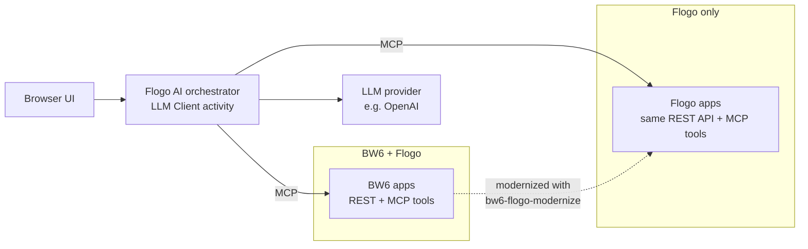

# TIBCO BusinessWorks 6 + Flogo Samples

Agentic AI samples that pair **TIBCO BusinessWorks 6 (BW6)** with **TIBCO Flogo®**. Each sample ships the same use case two ways:

- **BW6 + Flogo ("better together")** - the original BW6 apps provide the domain services and expose them as REST and MCP (Model Context Protocol) tools; a Flogo app or a browser agent does the AI orchestration.
- **Flogo only** - every BW6 app **modernized** as a Flogo 2.x app with the same REST API and the same MCP tools, plus a Flogo AI orchestrator. No BW6 runtime needed.

So you can show an existing BW6 estate becoming AI-callable, and then the same services running on Flogo.

## Samples

| Sample | Industry | What it shows | BW6 apps | Flogo apps |
|---|---|---|---|---|
| [Retail - BW & Flogo, Better Together](./Retail_Store_Assistant/) | Retail & Consumer Goods | A store associate asks about inventory, orders, returns, promotions and store policy. A Flogo orchestrator (`POST /api/query`) uses one LLM Client activity to plan, call the MCP tools and answer. Write actions go through manager approval in SQL Server. | 7 modules (inventory, orders, promotions, policy RAG, operations/approvals, MCP gateway, legacy agent) | 6 apps: 4 REST + MCP servers, an operations API on SQL Server, and the orchestrator |
| [Industrial Gas - Smart Operations](./Industrial_Gas_AI_Ops/) | Manufacturing / Industrial Gases | A gas-cylinder operation: an AI agent searches stock, checks a cylinder's status and certificate, and dispatches it; a document assistant ingests safety data sheets and SOPs into a vector store and answers questions with citations (optionally with an image). | 3 apps (cylinder operations, document ingestion, document query) | 4 apps: 3 REST + MCP servers and a Flogo AI orchestrator (`POST /api/chat`) |

Each sample's README has the architecture diagrams, what every app does, prerequisites and run steps for both paths, and troubleshooting.

## How the pieces fit

The orchestrator does not change between the paths: only its MCP connections point at the BW6 MCP endpoint or at the Flogo apps' MCP servers.

## How the Flogo apps were built

The Flogo apps were generated from the BW6 sources with the [`bw6-flogo-modernize`](../../../skills-library/.claude/skills/bw6-flogo-modernize/) skill, using the Flogo Design CLI (`fda`) only:

1. **Analyze** each BW6 module: REST bindings, MCP-exposed operations, processes, activities, XSLT mappings, shared resources and module properties.
2. **Plan** the modernization (1:1 trigger/activity/connection/property mapping, gaps and workarounds) and get approval.
3. **Build** the Flogo app from the same OpenAPI: a REST trigger with the same paths and an MCP server trigger with the same tools.
4. **Verify** it side by side against the running BW6 app (same requests, compared responses), and check that the app opens cleanly in the Flogo designer.

| BW6 | Flogo |
|---|---|
| REST service binding | REST trigger generated from the same OpenAPI spec |
| Operations exposed as MCP tools | MCP server trigger, one tool per operation |
| Processes and XSLT mappings | Flows with mapper / activity mappings and Flogo expressions |
| JDBC shared resource | Database connector (e.g. SQL Server) |
| AI / RAG palette | Agentic AI LLM Client, OpenAI vector-store activities, Invoke REST |
| Module properties / substitution variables | App properties (override at run time with environment variables) |

## Prerequisites

What you need depends on the path. Each sample's README lists the exact versions and extras (SQL Server, Docker, Node.js, ...).

| Need | Flogo only | BW6 + Flogo |
|---|---|---|
| VS Code + **TIBCO Flogo® extension 2.26.9** or later (design, run from VS Code) | Yes | Yes |
| **Flogo App Build CLI** (`flogobuild`) + **Go 1.25.7+** (build executables) | Yes | Yes |
| **LLM API key** with a tool-calling model (the samples default to `gpt-5.5`; nano-class models drop tool calls) | Yes | Yes |
| **TIBCO BusinessWorks 6** runtime + **TIBCO Business Studio** (6.12, with the AI/RAG and MCP palettes the sample uses) | - | Yes |
| A modern browser (Chrome, Edge, Firefox) | Yes | Yes |

Downloads: [Flogo VS Code extension and Flogo App Build CLI](https://www.tibco.com/downloads/11810). See the repository's [prerequisite tiers](../../../skills-library/AGENT.md#prerequisites-and-preflight) for install hints.

These samples do not use the `agentic-ai-use-case-builder` skill or the governed three-app pattern of [`Industry_Use_Cases/`](../Industry_Use_Cases/); the domain logic comes from the BW6 apps.

## Notes

- **Secrets:** the `.flogo` files and BW6 resources ship with placeholders (`YOUR_OPENAI_API_KEY`). Supply your key at run time, for example `FLOGO_APP_PROPS_ENV=auto OPENAI_API_KEY=<your-key> ./<App>`, or set it in the designer. Never commit real keys.
- **Run order:** start the apps that host MCP servers first and the AI orchestrator last; it connects to the MCP servers when it starts.
- **Ports:** each sample's README lists its ports. Avoid ports that browsers block (for example 6000) for anything a browser page calls.
- All data in these samples is fictional and for demonstration only.
