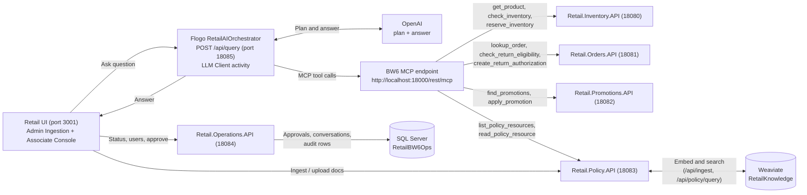
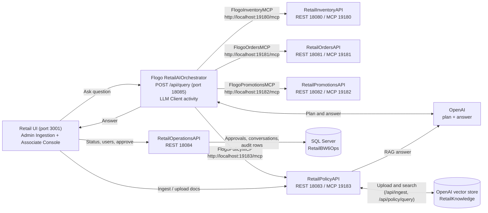

# Retail Agentic AI - BW & Flogo: Better Together

A retail agentic AI demo for a generic store, "ACME Store". A store associate asks questions in plain language in a web UI, for example "Is RUN-PEG-001 available at SFO-001?" or "Can I return order ORD-1001?". The **Flogo RetailAIOrchestrator** passes each question to one **Agentic AI LLM Client** activity. That activity plans which tools to call, calls them over **MCP (Model Context Protocol)**, and writes the answer. The tools are retail domain services for inventory, orders, promotions and store policy.

The same demo runs in two ways:

| Path | Domain services and MCP tools | AI orchestrator | Policy RAG store |
|---|---|---|---|
| **1. BW6 + Flogo** | TIBCO BusinessWorks 6 modules in `BW_Apps/`. The BW6 MCP endpoint (`:18000/rest/mcp`) exposes their operations as tools. | Flogo `RetailAIOrchestrator` with **one** MCP connection, to the BW6 MCP endpoint | Weaviate |
| **2. Flogo only** | Flogo apps in `FLOGO-Apps/`, modernized from the BW6 modules. Each app has its own MCP server. | Flogo `RetailAIOrchestrator` with **four** MCP connections, one per Flogo app | OpenAI vector store |

Both paths use the same REST ports, the same tool names, the same SQL Server database and the same UI. You can run the demo on BW6, then stop BW6, start the Flogo apps and run it again without changing the UI.

## Contents

- [Architecture](#architecture)
- [Apps](#apps)
- [Folder layout](#folder-layout)
- [Prerequisites](#prerequisites)
- [Setup](#setup)
- [Run path 1: BW6 + Flogo](#run-path-1-bw6--flogo)
- [Run path 2: Flogo only](#run-path-2-flogo-only)
- [Using the UI](#using-the-ui)
- [Demo scenarios](#demo-scenarios)
- [Approval flow](#approval-flow)
- [Reset before a demo](#reset-before-a-demo)
- [How it was modernized from BW6](#how-it-was-modernized-from-bw6)
- [Troubleshooting](#troubleshooting)
- [Known limitations](#known-limitations)

## Architecture

### Path 1: BW6 + Flogo



### Path 2: Flogo only



### The orchestrator flow

The Flogo orchestrator has one flow, `process_retail_query`, with three steps:

```
ReceiveHTTPMessage (POST /api/query, port 18085)
    -> PlanAndExecute  (Agentic AI LLM Client activity, connected to the MCP server(s))
    -> ReturnResponse  (HTTP 200: {"answer", "toolsUsed", "confidence"})
```

**PlanAndExecute** works like this:

1. It builds a prompt from the request's `question`, `customerId` and `storeId`, and uses the system prompt in the app property `RetailAgent.SystemPrompt`.
2. The LLM reads the tool list from every connected MCP server and decides which tools to call.
3. The activity calls those tools over MCP (streamable HTTP) and gives the results back to the LLM.
4. The LLM writes the final answer, and the flow returns it to the caller.

This one activity replaces the original BW6 agent: `Retail.Agent.API` with its Java planner and answer generator, plus the `Retail.MCP.Gateway.API` bridge. That is five custom Java classes, about 1,900 lines. In this "Better Together" story, Flogo handles the AI orchestration and BW6 (or its modernized Flogo apps) provides the domain APIs.

## Apps

### BW6 modules (`BW_Apps/`)

| Module | Port | REST endpoints | MCP tools | Role in this demo |
|---|---|---|---|---|
| `Retail.Inventory.API` | 18080 | `GET /api/inventory/products/{sku}`, `GET /api/inventory/availability?sku=&storeId=`, `POST /api/inventory/reservations`, plus helper endpoints under `/api/inventory/tools` | `get_product`, `check_inventory`, `reserve_inventory` (write) | Products, stock by store and aisle, reservation requests |
| `Retail.Orders.API` | 18081 | `GET /api/orders/{orderId}`, `GET /api/orders/returns/eligibility?orderId=`, `POST /api/orders/return-authorizations` | `lookup_order`, `check_return_eligibility`, `create_return_authorization` (write) | Orders, return windows, return requests |
| `Retail.Promotions.API` | 18082 | `GET /api/promotions?customerId=&category=`, `POST /api/promotions/applications` | `find_promotions`, `apply_promotion` (write) | Loyalty promotions |
| `Retail.Policy.API` | 18083 | `GET /api/policy/resources`, `GET /api/policy/resources/{id}`, `GET /api/policy/resources/read?uri=`, `POST /api/ingest`, `POST /api/upload`, `POST /api/policy/query` | `list_policy_resources`, `read_policy_resource` | Store policy catalog, plus RAG ingestion and query (BW6 AI plugin + Weaviate) |
| `Retail.Operations.API` | 18084 | `GET /api/status`, `GET /api/users`, `GET /api/demo/scenarios`, `POST /api/approve`, `GET /api/operations`, `GET /api/conversations`, `GET /api/conversations/{conversationId}`, `POST /api/demo/reset`, `POST /api/evals` | none | UI back end: users, status, approvals, conversation history and reset (SQL Server via JDBC) |
| `Retail.MCP.Gateway.API` | 18086 | `GET /api/mcp/tools`, `POST /api/mcp/tools/call` | none | REST wrapper that reaches the BW6 MCP endpoint through `npx mcp-remote` (Node.js). **Not needed** with the Flogo orchestrator. |
| `Retail.Agent.API` | 18085 | `POST /api/query` | none | The original all-BW6 agent (Java planner). **Replaced** by the Flogo orchestrator, which uses the same port, so don't run both. |
| `Retail.Shared` | | | | Shared module |

The domain modules return built-in sample data: 10 products, 3 stores, 5 orders, 4 customers and 5 policy documents. They don't use a database. The write tools never change anything. They answer "approval required" (see [Approval flow](#approval-flow)).

The BW6 MCP endpoint serves the operations marked as MCP tools in each module's `META-INF/module.bwm`, across every running module, at `http://localhost:18000/rest/mcp`.

### Flogo apps (`FLOGO-Apps/`, Flogo 2.26.9)

| App | Replaces | REST port | MCP server | MCP tools | What it does |
|---|---|---|---|---|---|
| `RetailInventoryAPI.flogo` | `Retail.Inventory.API` | 18080 | `http://localhost:19180/mcp` | `get_product`, `check_inventory`, `reserve_inventory` | Same REST API, data and tools as the BW6 module |
| `RetailOrdersAPI.flogo` | `Retail.Orders.API` | 18081 | `http://localhost:19181/mcp` | `lookup_order`, `check_return_eligibility`, `create_return_authorization` | Same REST API, data and tools as the BW6 module |
| `RetailPromotionsAPI.flogo` | `Retail.Promotions.API` | 18082 | `http://localhost:19182/mcp` | `find_promotions`, `apply_promotion` | Same REST API, data and tools as the BW6 module |
| `RetailPolicyAPI.flogo` | `Retail.Policy.API` | 18083 | `http://localhost:19183/mcp` | `list_policy_resources`, `read_policy_resource` | Policy catalog. RAG uses an **OpenAI vector store** (`RetailKnowledge`) through the repo's [OpenAI extension](../../../../extensions/openAI/), and an LLM Client activity writes the answer. |
| `RetailOperationsAPI.flogo` | `Retail.Operations.API` | 18084 | none | none | Same UI back-end API, on the same SQL Server database, through the Flogo SQL Server connector (connection `RetailOpsDB`) |
| `RetailAIOrchestrator.flogo` | `Retail.Agent.API` + `Retail.MCP.Gateway.API` | 18085 | client only | uses all 10 tools | `POST /api/query`. One LLM Client activity with four MCP connections: `FlogoInventoryMCP`, `FlogoOrdersMCP`, `FlogoPromotionsMCP`, `FlogoPolicyMCP`. |

Each Flogo domain app reads its ports from the app properties `REST_PORT` (number) and `MCP_PORT` (string). Each MCP tool runs the same flow as the matching REST operation, so the REST and MCP answers are the same.

## Folder layout

```
Retail_Store_Assistant/
├── BW_Apps/                       # BW6 modules (import into TIBCO Business Studio)
│   ├── Retail.Inventory.API       #   18080 - products, availability, reservations
│   ├── Retail.Orders.API          #   18081 - orders, return eligibility, return requests
│   ├── Retail.Promotions.API      #   18082 - promotions
│   ├── Retail.Policy.API          #   18083 - policy catalog, ingest/upload, RAG query (Weaviate)
│   ├── Retail.Operations.API      #   18084 - users, status, approvals, conversations (SQL Server)
│   ├── Retail.MCP.Gateway.API     #   18086 - REST wrapper for MCP tools (not used by the Flogo orchestrator)
│   ├── Retail.Agent.API           #   18085 - original BW6 agent (replaced by the Flogo orchestrator)
│   ├── Retail.Shared              #   shared module
│   └── *.application              #   BW6 application projects
├── FLOGO-Apps/                    # Flogo 2.x apps
│   ├── RetailAIOrchestrator.flogo #   18085 - AI orchestrator (wired to the four Flogo MCP servers)
│   ├── RetailInventoryAPI.flogo   #   18080 / MCP 19180
│   ├── RetailOrdersAPI.flogo      #   18081 / MCP 19181
│   ├── RetailPromotionsAPI.flogo  #   18082 / MCP 19182
│   ├── RetailPolicyAPI.flogo      #   18083 / MCP 19183 (OpenAI extension)
│   └── RetailOperationsAPI.flogo  #   18084 (SQL Server)
└── RetailBW6-UI/                  # static web UI (index.html, app.js, styles.css)
```

## Prerequisites

### Common (both paths)

| Prerequisite | Version / details |
|---|---|
| **VS Code + TIBCO Flogo VS Code extension** | **2.26.9** or later (the `.flogo` files were saved with 2.26.9). Download it from the [TIBCO downloads page](https://www.tibco.com/downloads/11810) or the VS Code Marketplace. |
| **Docker** | Runs SQL Server (and Weaviate on path 1) |
| **OpenAI API key** | Used by the Flogo orchestrator. On path 2 the Flogo Policy app uses it too. On path 1 the BW6 Policy module uses it. |
| **LLM model** | A tool-calling model. The apps default to `gpt-5.5`. Nano-class models tend to skip tool calls, so don't use them. |
| **Python 3** | Or any other static file server, to serve the UI |

To build the Flogo apps as executables instead of running them from VS Code, you also need:

| Prerequisite | Version / details |
|---|---|
| **Flogo App Build CLI (`flogobuild`)** | 1.0.6 or later. Download it from the [TIBCO downloads page](https://www.tibco.com/downloads/11810). It isn't included in the VS Code extension. |
| **Go** | 1.25.7 or later ([go.dev/dl](https://go.dev/dl/)) |
| **Flogo licence file** | Optional. Without one, local builds on Windows and macOS run in non-production mode and stop after 24 hours. |

### Path 1: BW6 + Flogo

| Prerequisite | Version / details |
|---|---|
| **TIBCO BusinessWorks 6** | **6.12.0 HF3** or later, with the **AI plugin** (RAG), **JDBC** and **REST/JSON** palettes, and the **BW6 MCP server** feature |
| **Java** | JDK 17 or later |
| **Weaviate** | Docker container (see [Setup](#4-weaviate-path-1-only)) |
| **Node.js** | Only if you also run `Retail.MCP.Gateway.API`. It calls `npx mcp-remote`. The Flogo orchestrator doesn't need it. |

### Path 2: Flogo only

No BW6, Weaviate or Node.js is needed. The Flogo Policy app keeps its knowledge in an **OpenAI vector store**. Your OpenAI key needs access to the Files and Vector Stores APIs. To build `RetailPolicyAPI` you need a `flogobuild` context that includes this repo's `extensions/` folder (see [Build the Flogo apps](#6-build-the-flogo-apps)).

## Setup

### 1. Docker network

The containers below join a user-defined network. Create it once:

```bash
docker network create ai-demo-network
```

### 2. SQL Server (both paths)

> **Note:** The passwords below (`bw6retail@123`, `bw6retail@456`) are example values for a local Docker instance only. Change them before any non-local use.

```bash
docker run -d \
  --network ai-demo-network \
  --platform linux/amd64 \
  --name retail-bw6-sqlserver \
  -e "ACCEPT_EULA=Y" \
  -e "MSSQL_PID=Developer" \
  -e "MSSQL_SA_PASSWORD=bw6retail@123" \
  -p 14333:1433 \
  -v retail-bw6-sqlserver-data:/var/opt/mssql \
  mcr.microsoft.com/mssql/server:2022-latest
```

Create the database and user:

```bash
docker exec -it retail-bw6-sqlserver /opt/mssql-tools18/bin/sqlcmd \
  -S localhost -U sa -P 'bw6retail@123' -C
```

```sql
CREATE DATABASE RetailBW6Ops;
GO
USE RetailBW6Ops;
GO
CREATE LOGIN retail_bw6_ops_user WITH PASSWORD = 'bw6retail@456';
GO
CREATE USER retail_bw6_ops_user FOR LOGIN retail_bw6_ops_user;
GO
ALTER ROLE db_owner ADD MEMBER retail_bw6_ops_user;
GO
```

Then create the tables:

```sql
USE RetailBW6Ops;
GO

-- Approvals
CREATE TABLE retail_approvals (
  approval_id uniqueidentifier NOT NULL DEFAULT NEWID() PRIMARY KEY,
  tool_name nvarchar(120) NOT NULL,
  arguments_json nvarchar(max) NOT NULL,
  summary nvarchar(max) NOT NULL,
  status nvarchar(20) NOT NULL DEFAULT 'pending',
  created_at datetimeoffset NOT NULL DEFAULT SYSDATETIMEOFFSET(),
  completed_at datetimeoffset NULL,
  approved_by_json nvarchar(max) NULL,
  result_json nvarchar(max) NULL,
  CONSTRAINT ck_retail_approvals_status CHECK (status IN ('pending','approved','rejected')),
  CONSTRAINT ck_retail_approvals_arguments_json CHECK (ISJSON(arguments_json) = 1),
  CONSTRAINT ck_retail_approvals_approved_by_json CHECK (approved_by_json IS NULL OR ISJSON(approved_by_json) = 1),
  CONSTRAINT ck_retail_approvals_result_json CHECK (result_json IS NULL OR ISJSON(result_json) = 1)
);
CREATE INDEX retail_approvals_status_created_idx ON retail_approvals (status, created_at DESC);

-- Reservations
CREATE TABLE retail_reservations (
  reservation_id nvarchar(80) NOT NULL PRIMARY KEY,
  approval_id uniqueidentifier NULL REFERENCES retail_approvals(approval_id),
  sku nvarchar(80) NOT NULL,
  product_name nvarchar(240) NULL,
  store_id nvarchar(80) NOT NULL,
  customer_id nvarchar(80) NOT NULL,
  quantity_reserved int NOT NULL DEFAULT 1,
  expires_in_minutes int NOT NULL DEFAULT 90,
  created_at datetimeoffset NOT NULL DEFAULT SYSDATETIMEOFFSET()
);
CREATE INDEX retail_reservations_created_idx ON retail_reservations (created_at DESC);

-- Return Authorizations
CREATE TABLE retail_return_authorizations (
  return_authorization_id nvarchar(80) NOT NULL PRIMARY KEY,
  approval_id uniqueidentifier NULL REFERENCES retail_approvals(approval_id),
  order_id nvarchar(80) NOT NULL,
  sku nvarchar(80) NULL,
  product_name nvarchar(240) NULL,
  status nvarchar(40) NOT NULL DEFAULT 'created',
  created_at datetimeoffset NOT NULL DEFAULT SYSDATETIMEOFFSET()
);
CREATE INDEX retail_return_authorizations_created_idx ON retail_return_authorizations (created_at DESC);

-- Promotion Applications
CREATE TABLE retail_promotion_applications (
  promotion_application_id nvarchar(80) NOT NULL PRIMARY KEY,
  approval_id uniqueidentifier NULL REFERENCES retail_approvals(approval_id),
  customer_id nvarchar(80) NOT NULL,
  promotion_id nvarchar(120) NOT NULL,
  sku nvarchar(80) NOT NULL,
  status nvarchar(40) NOT NULL DEFAULT 'applied',
  created_at datetimeoffset NOT NULL DEFAULT SYSDATETIMEOFFSET()
);
CREATE INDEX retail_promotion_applications_created_idx ON retail_promotion_applications (created_at DESC);

-- Conversations
CREATE TABLE retail_conversations (
  conversation_id uniqueidentifier NOT NULL DEFAULT NEWID() PRIMARY KEY,
  user_id nvarchar(120) NULL,
  customer_id nvarchar(120) NULL,
  store_id nvarchar(120) NULL,
  title nvarchar(500) NOT NULL,
  created_at datetimeoffset NOT NULL DEFAULT SYSDATETIMEOFFSET(),
  updated_at datetimeoffset NOT NULL DEFAULT SYSDATETIMEOFFSET()
);
CREATE INDEX retail_conversations_updated_idx ON retail_conversations (updated_at DESC);

-- Conversation Messages
CREATE TABLE retail_conversation_messages (
  message_id uniqueidentifier NOT NULL DEFAULT NEWID() PRIMARY KEY,
  conversation_id uniqueidentifier NOT NULL REFERENCES retail_conversations(conversation_id) ON DELETE CASCADE,
  role nvarchar(20) NOT NULL CHECK (role IN ('user','assistant','system')),
  content nvarchar(max) NOT NULL,
  user_id nvarchar(120) NULL,
  created_at datetimeoffset NOT NULL DEFAULT SYSDATETIMEOFFSET(),
  trace_json nvarchar(max) NULL CHECK (trace_json IS NULL OR ISJSON(trace_json) = 1)
);
CREATE INDEX retail_conversation_messages_conversation_idx ON retail_conversation_messages (conversation_id, created_at);
GO
```

Both Operations apps use this database:

- **BW6** (`Retail.Operations.API`, JDBC shared resource `JDBCConnectionResource`):
  `jdbc:sqlserver://127.0.0.1:14333;databaseName=RetailBW6Ops;encrypt=true;trustServerCertificate=true`, user `retail_bw6_ops_user`.
- **Flogo** (`RetailOperationsAPI`, connection `RetailOpsDB`): app properties `SQLServer.RetailOpsDB.Host` (`localhost`), `SQLServer.RetailOpsDB.Port` (`14333`), `SQLServer.RetailOpsDB.Database_Name` (`RetailBW6Ops`), `SQLServer.RetailOpsDB.User` (`retail_bw6_ops_user`) and `SQLServer.RetailOpsDB.Password`.

### 3. Policy knowledge store

The policy knowledge base holds five seed documents: General Return Policy, Electronics Return Policy, Warranty Policy, Inventory and Pickup FAQ, and Spring Trail Promotion. They are built into the Policy app. You load them into the knowledge store by calling `POST /api/ingest`, from the UI's **Admin Ingestion** panel or with curl (see the Run sections). Ingestion and `POST /api/policy/query` (RAG) use the store. The agent's policy tools (`list_policy_resources`, `read_policy_resource`) read the built-in catalog, so chat works even before you ingest.

- **Path 1** stores the documents in Weaviate (next step).
- **Path 2** stores them in an **OpenAI vector store** named by the app property `VECTOR_STORE_NAME` (`RetailKnowledge`). You don't need to set anything up first. The first ingest, upload or query creates the store if it doesn't exist. The app writes each document to a local folder (app property `POLICY_DOCS_DIR`, default `policy_docs`, relative to the folder you start the app from) and then uploads it.

### 4. Weaviate (path 1 only)

```bash
docker run -d \
  --network ai-demo-network \
  --name retail-weaviate \
  -p 8080:8080 \
  -p 50051:50051 \
  -e QUERY_DEFAULTS_LIMIT=25 \
  -e AUTHENTICATION_ANONYMOUS_ACCESS_ENABLED=true \
  -e PERSISTENCE_DATA_PATH=/var/lib/weaviate \
  -e DEFAULT_VECTORIZER_MODULE=none \
  -e CLUSTER_HOSTNAME=node1 \
  -v retail-weaviate-data:/var/lib/weaviate \
  semitechnologies/weaviate:latest
```

Verify Weaviate is running:

```bash
curl -s http://localhost:8080/v1/meta | jq
```

Create the `RetailKnowledge` collection:

```bash
export WEAVIATE_URL=http://localhost:8080

curl -s -X POST "$WEAVIATE_URL/v1/schema" \
  -H "Content-Type: application/json" \
  -d '{
    "class": "RetailKnowledge",
    "description": "Retail policy, FAQ, and uploaded knowledge chunks for BW6 RAG queries.",
    "vectorizer": "none",
    "vectorIndexType": "hnsw",
    "vectorIndexConfig": { "distance": "cosine", "efConstruction": 128, "maxConnections": 32 },
    "properties": [
      { "name": "chunkId",      "dataType": ["text"] },
      { "name": "documentId",   "dataType": ["text"] },
      { "name": "title",        "dataType": ["text"] },
      { "name": "documentType", "dataType": ["text"] },
      { "name": "source",       "dataType": ["text"] },
      { "name": "uri",          "dataType": ["text"] },
      { "name": "text",         "dataType": ["text"] },
      { "name": "category",     "dataType": ["text"] },
      { "name": "tags",         "dataType": ["text[]"] },
      { "name": "createdAt",    "dataType": ["date"] }
    ]
  }' | jq
```

> The collection uses `vectorizer = none` because the BW6 AI plugin generates the embeddings.

### 5. App properties and secrets

The committed files contain **placeholders**, not working keys or passwords. Set your values before you run the apps.

#### Flogo apps

To set an app property, open the `.flogo` file in VS Code and go to **App Properties**. The designer encrypts values you type into password-type fields. You can also override a property when you start the app, with `FLOGO_APP_PROPS_ENV=auto <PROPERTY_NAME>=<value>`. For property names that contain dots, set the value in the designer.

| App | Property | Default | What to set |
|---|---|---|---|
| `RetailAIOrchestrator` | `LLMClient.API_Key` | placeholder | **Required.** Your OpenAI API key. Set it in the designer. |
| | `LLMClient.LLM_Provider` | `OpenAI` | Change it if you use a different provider |
| | `LLMClient.LLM_Model` | `gpt-5.5` | Any tool-calling model |
| | `RetailAgent.SystemPrompt` | pre-configured | Optional. Defines the assistant's behavior and tool rules. |
| `RetailPolicyAPI` | `OPENAI_API_KEY` | `YOUR_OPENAI_API_KEY` | **Required.** Your OpenAI API key. Set it in the designer, or at run time with `FLOGO_APP_PROPS_ENV=auto OPENAI_API_KEY=<your-openai-api-key>`. |
| | `OPENAI_API_ENDPOINT_URL` | `https://api.openai.com/v1` | Change it for an OpenAI-compatible endpoint |
| | `LLM_PROVIDER` / `LLM_MODEL` | `OpenAI` / `gpt-5.5` | The model that writes the RAG answer |
| | `VECTOR_STORE_NAME` | `RetailKnowledge` | Name of the OpenAI vector store. It is found by name and created if missing. |
| | `POLICY_DOCS_DIR` | `policy_docs` | Local folder for document files before upload. It is relative to the working directory. |
| `RetailOperationsAPI` | `SQLServer.RetailOpsDB.Password` | placeholder | **Required.** The `retail_bw6_ops_user` password. Set it in the designer. |
| | `SQLServer.RetailOpsDB.Host` / `Port` / `Database_Name` / `User` | `localhost` / `14333` / `RetailBW6Ops` / `retail_bw6_ops_user` | Change them if your SQL Server is elsewhere |
| all domain apps | `REST_PORT` / `MCP_PORT` | see [Apps](#apps) | Optional. Override them to move an app, for example `FLOGO_APP_PROPS_ENV=auto REST_PORT=19080`. |

The orchestrator's listening port (18085) is set on its REST trigger. The MCP server URLs are set on its MCP connections, not in app properties. The `REST_Port` and `MCP_Server_URL` app properties are not used.

#### BW6 modules (path 1)

Open the projects in TIBCO Business Studio for BusinessWorks:

- **`Retail.Policy.API` → shared resource `RAGConfiguration`**: enter your **OpenAI key**. The defaults are chat model `gpt-4.1-mini` and embeddings `text-embedding-3-small`. Weaviate is at `localhost:8080`, scheme HTTP, object class `RetailKnowledge`. Change the host and port if Weaviate runs elsewhere.
- **`Retail.Operations.API` → shared resource `JDBCConnectionResource`**: enter the `retail_bw6_ops_user` password. Change the JDBC URL if your SQL Server isn't on `127.0.0.1:14333`.

### 6. Build the Flogo apps

Skip this step if you run the apps from VS Code: right-click the `.flogo` file and choose **Run**, or use **Configure and Run** to pass environment variables.

Create the build contexts once, from the Flogo VS Code extension `.vsix` (2.26.9). Context names may contain letters, digits, `_` and `-`, must be 3 to 30 characters long, and can't contain dots.

```bash
# Standard context: Inventory, Orders, Promotions, Operations, Orchestrator
flogobuild create-context -n flogo2269 -v <path-to-flogo-vscode-extension-2.26.9.vsix>

# Context with this repo's user extensions: required for RetailPolicyAPI (OpenAI vector store activities)
flogobuild create-context -n flogo2269openai -v <path-to-flogo-vscode-extension-2.26.9.vsix> \
  -u <absolute-path-to-repo>/extensions

flogobuild list-context
```

Build from the `FLOGO-Apps` folder. Pass the app file name without a folder, and an **absolute** output folder:

```bash
cd samples/Agentic_AI/BW6_Flogo_Samples/Retail_Store_Assistant/FLOGO-Apps

for app in RetailInventoryAPI RetailOrdersAPI RetailPromotionsAPI RetailOperationsAPI RetailAIOrchestrator; do
  flogobuild build-exe -f $app.flogo -c flogo2269 -o <absolute-output-dir>
done
flogobuild build-exe -f RetailPolicyAPI.flogo -c flogo2269openai -o <absolute-output-dir>
```

On Windows the executables have the `.exe` extension.

## Run path 1: BW6 + Flogo

### 1. Start the containers

Start `retail-bw6-sqlserver` and `retail-weaviate` (`docker start retail-bw6-sqlserver retail-weaviate`).

### 2. Start the BW6 modules with the MCP server enabled

1. Import the projects in `BW_Apps/` into TIBCO Business Studio for BusinessWorks.
2. Enable the BW6 MCP server: add the JVM argument `-Dbw.enable.mcp.server=true` to the AppNode or the Studio run configuration.
3. Start these applications:
   - `Retail.Inventory.API`
   - `Retail.Orders.API`
   - `Retail.Promotions.API`
   - `Retail.Policy.API`
   - `Retail.Operations.API`
4. Check that the MCP endpoint answers at `http://localhost:18000/rest/mcp`. If your BW6 runtime serves MCP on a different host or port, use that URL in the next step.

Don't start `Retail.Agent.API`, because the Flogo orchestrator replaces it on port 18085. `Retail.MCP.Gateway.API` is optional (see [Optional checks](#optional-checks-path-1)).

### 3. Point the orchestrator at the BW6 MCP endpoint

`FLOGO-Apps/RetailAIOrchestrator.flogo` ships connected to the four Flogo MCP servers. For path 1, connect it to the single BW6 endpoint instead. Use a copy if you want to keep both versions.

1. Open the orchestrator in VS Code.
2. Create an **MCP server** connection (Agentic AI) with these settings:
   - server type HTTP
   - transport streamable
   - auth None
   - URL `http://localhost:18000/rest/mcp`
3. In the flow `process_retail_query`, open the **PlanAndExecute** (LLM Client) activity. In its **MCP Servers** setting, select only the BW6 connection and remove `FlogoInventoryMCP`, `FlogoOrdersMCP`, `FlogoPromotionsMCP` and `FlogoPolicyMCP`.
4. Save, and build or run it.

The BW6 endpoint lists the tools of every running module. To show the agent only the 10 retail tools, limit the connection's selected tools (`selectedTools`).

> **Mixing BW6 and Flogo tools.** You can connect the orchestrator to the BW6 endpoint **and** to some Flogo MCP servers. Limit the BW6 connection's selected tools so that each tool name is served only once. The [bw6-flogo-modernize](../../../../skills-library/.claude/skills/bw6-flogo-modernize/) skill's `scripts/rewire_orchestrator.py` automates this with the Flogo Design CLI. It copies a BW6-connected orchestrator, adds one MCP connection per Flogo app (`--flogo-mcp Name=http://localhost:<port>/mcp`), limits the BW6 connection to the remaining tools (`--bw-mcp <connection name>` picks the BW6 connection), and with `--flogo-only` drops BW6 completely. The source file is never modified.

### 4. Start the orchestrator last

Start it from VS Code (**Run**) or as the executable you built. It must start **after** the MCP endpoint is up. If you restart a BW6 module, restart the orchestrator too.

```
INFO  [flogo.flow]  - Executing Flow Instance [...] for event id [...]
INFO  [flogo.agentai.activity.llmclientactivity]  - Processing tool callsmap[count:1 iteration:1]
INFO  [flogo.agentai.activity.llmclientactivity]  - Executing toolmap[toolName:find_promotions]
INFO  [flogo.agentai.activity.llmclientactivity]  - Input Tokens: [2077], Output Tokens: [806], Total Tokens: [2883], Reasoning Tokens: [678]
INFO  [flogo.flow]  - Flow Instance [...] completed in 12.6595443s
```

Each query logs the MCP tools it called and its token usage.

### 5. Ingest the policy documents into Weaviate

Use the **Admin Ingestion** panel in the UI, or:

```bash
curl -s -X POST http://localhost:18083/api/ingest \
  -H "Content-Type: application/json" \
  -d '{ "source": "seed", "documentTypes": ["policy", "faq", "promotion"], "resetCollection": false }' | jq
```

Expected: the source and chunk counts are greater than 0, and the storage collection is `RetailKnowledge`. Check Weaviate:

```bash
curl -s "http://localhost:8080/v1/objects?class=RetailKnowledge&limit=5" | jq
```

### 6. Start the UI

See [Using the UI](#using-the-ui).

### Optional checks (path 1)

```bash
# Operations status
curl -s http://localhost:18084/api/status | jq

# Policy RAG query (Weaviate)
curl -s -X POST http://localhost:18083/api/policy/query \
  -H "Content-Type: application/json" \
  -d '{ "question": "What is the electronics return policy?", "topK": 5, "minScore": 0 }' | jq
```

`Retail.MCP.Gateway.API` (port 18086) lets you call a BW6 MCP tool over plain REST. It needs Node.js (`npx` on `PATH`), and it reads the BW6 MCP URL from `MCP_REMOTE_URL` (default `http://localhost:18000/rest/mcp`):

```bash
curl -s -X POST http://localhost:18086/api/mcp/tools/call \
  -H "Content-Type: application/json" \
  -d '{ "toolName": "check_inventory", "arguments": { "sku": "RUN-PEG-001", "storeId": "SFO-001" } }' | jq
```

## Run path 2: Flogo only

The Flogo apps use the **same REST ports** as the BW6 modules, so stop the BW6 applications first. To run both stacks at the same time, move the Flogo apps to other ports with `REST_PORT` and change the URLs in `RetailBW6-UI/app.js`.

### 1. Start SQL Server

```bash
docker start retail-bw6-sqlserver
```

Weaviate isn't needed.

### 2. Start the domain apps

Run each app from VS Code (**Run**, or **Configure and Run** for environment variables), or start the executables you built, each in its own terminal. Run `RetailPolicyAPI` from a folder where it may create its `policy_docs/` folder.

Git Bash, Linux or macOS:

```bash
cd <absolute-output-dir>
./RetailOperationsAPI        # REST 18084 (needs SQL Server)
./RetailInventoryAPI         # REST 18080, MCP 19180
./RetailOrdersAPI            # REST 18081, MCP 19181
./RetailPromotionsAPI        # REST 18082, MCP 19182
FLOGO_APP_PROPS_ENV=auto OPENAI_API_KEY=<your-openai-api-key> ./RetailPolicyAPI   # REST 18083, MCP 19183
```

PowerShell, for the Policy app:

```powershell
$env:FLOGO_APP_PROPS_ENV = "auto"
$env:OPENAI_API_KEY = "<your-openai-api-key>"
.\RetailPolicyAPI.exe
```

In VS Code **Configure and Run**, use the environment variables `FLOGO_APP_PROPS_ENV=auto,OPENAI_API_KEY=<your-openai-api-key>`.

If you set `OPENAI_API_KEY` in the designer, you don't need the environment variables.

### 3. Start the orchestrator last

`FLOGO-Apps/RetailAIOrchestrator.flogo` is already connected to the four Flogo MCP servers (`http://localhost:19180/mcp` to `http://localhost:19183/mcp`). Set `LLMClient.API_Key` first (see [App properties and secrets](#5-app-properties-and-secrets)), then:

```bash
./RetailAIOrchestrator       # REST 18085
```

Start it **after** all four MCP servers are up. If you restart a domain app, restart the orchestrator too.

### 4. Ingest the policy documents into the OpenAI vector store

Use the **Admin Ingestion** panel in the UI, or:

```bash
curl -s -X POST http://localhost:18083/api/ingest \
  -H "Content-Type: application/json" \
  -d '{ "source": "seed", "documentTypes": ["policy", "faq", "promotion"], "resetCollection": false }' | jq
```

Expected: `ingestion.sourceCount` is 5, and `ingestion.storage` is `{"provider": "openai", "collection": "RetailKnowledge"}`. The first call creates the vector store. Then try a RAG query:

```bash
curl -s -X POST http://localhost:18083/api/policy/query \
  -H "Content-Type: application/json" \
  -d '{ "question": "What is the electronics return policy?", "topK": 5, "minScore": 0 }' | jq
```

The response contains `answer`, `retrieval` and `citations`.

### 5. Start the UI

See [Using the UI](#using-the-ui).

### Quick checks (path 2)

```bash
curl -s http://localhost:18084/api/status | jq
curl -s "http://localhost:18080/api/inventory/availability?sku=RUN-PEG-001&storeId=SFO-001" | jq
curl -s http://localhost:18081/api/orders/ORD-1001 | jq
curl -s "http://localhost:18082/api/promotions?customerId=CUST-001&category=outerwear" | jq
curl -s http://localhost:18083/api/policy/resources | jq
```

## Using the UI

The UI is in `RetailBW6-UI/`. It calls fixed URLs, set in `API_BASES` at the top of `RetailBW6-UI/app.js`:

| UI call | URL |
|---|---|
| `POST /api/query` | `http://localhost:18085` (orchestrator) |
| `POST /api/ingest`, `POST /api/upload` | `http://localhost:18083` (Policy) |
| everything else (status, users, scenarios, approve, conversations) | `http://localhost:18084` (Operations) |

These URLs are the same for both paths, so the UI works unchanged with either stack. Serve the folder with any static file server:

```bash
cd RetailBW6-UI
python3 -m http.server 3001      # on Windows: python -m http.server 3001
```

Open `http://localhost:3001`. When the UI loads:

- The status pill changes to **Ready**.
- The user dropdown fills with Casey Customer, Avery Associate, Morgan Manager and Alex Admin.
- The scenario and example buttons appear.
- The **Admin Ingestion** and **Associate Console** tabs are visible.

### Example conversation

LLM wording varies from run to run.

```
 YOU: What is the electronics return policy?
 COPILOT: Electronics Return Policy: Electronics, including sport watches and wireless
          earbuds, can be returned within 14 days of purchase. Items must include the
          charging cable, case, manuals, and original packaging. Open-box electronics
          may be inspected before a refund is issued.

 YOU: Is RUN-PEG-001 available at SFO-001?
 COPILOT: Yes — RUN-PEG-001 (AeroStride Running Shoe) is available at SFO-001.
          There are 12 in stock, located in aisle F3.

 YOU: Can I return order ORD-1001?
 COPILOT: Yes — order ORD-1001 is eligible for return. The AeroStride Running Shoe was
          purchased on 2026-04-20 and is within the 30-day return window at 20 days.

 YOU: Reserve RUN-PEG-001 at SFO-001 for CUST-001.
 COPILOT: AeroStride Running Shoe (RUN-PEG-001) is in stock at SFO-001 with 12 units
          available in aisle F3. The reservation for CUST-001 requires manager
          approval before it's finalized.
```

For each question, the UI calls the Flogo orchestrator. The orchestrator's LLM plans the tool calls, the MCP server(s) run them against the domain APIs, the LLM writes the answer, and the UI shows it.

### Agent query from the command line

```bash
curl -s -X POST http://localhost:18085/api/query \
  -H "Content-Type: application/json" \
  -d '{
    "question": "Is RUN-PEG-001 available at SFO-001?",
    "userId": "USR-ASSOCIATE-001",
    "customerId": "CUST-001",
    "storeId": "SFO-001"
  }' | jq
```

The response is `{"answer": "...", "toolsUsed": [], "confidence": "high"}`. The orchestrator log shows which tools were called.

## Demo scenarios

Run these from the **Associate Console**, with customer `CUST-001` and store `SFO-001`.

| # | Question | Tools the agent typically calls | Expected answer |
|---|---|---|---|
| 1 | `What is the electronics return policy?` | `list_policy_resources`, `read_policy_resource` | 14-day window. The item must include the charging cable, case, manuals and packaging. |
| 2 | `Is RUN-PEG-001 available at SFO-001?` | `get_product`, `check_inventory` | AeroStride Running Shoe, 12 in stock, aisle F3 |
| 3 | `Reserve RUN-PEG-001 at SFO-001 for CUST-001.` | `check_inventory`, `reserve_inventory` | In stock. The reservation **requires manager approval**, and nothing is reserved yet. |
| 4 | `Can I return order ORD-1001?` | `lookup_order`, `check_return_eligibility` | Eligible: 20 days into a 30-day return window |
| 5 | `Create a return for order ORD-1001.` | `lookup_order`, `check_return_eligibility`, `create_return_authorization` | Eligible. The return **requires manager approval**. |
| 6 | `Apply a promotion to RUN-PEG-001 for CUST-001.` | `get_product`, `find_promotions`, `apply_promotion` | Finds a promotion. Applying it **requires manager approval**. |
| 7 | `What warranty does a bag have?` | `list_policy_resources`, `read_policy_resource` | 24-month warranty |

## Approval flow

State-changing actions never run during a chat:

- The write tools (`reserve_inventory`, `create_return_authorization`, `apply_promotion`) don't change anything. They return `approvalRequired: true` (inventory returns `requiresApproval: true`), the tool name, the arguments, and the message *"This operation changes retail state and must be approved through the agent approval flow."* The agent tells the associate that manager approval is required.
- Only `POST /api/approve` on the Operations app (18084) changes state. It runs an approval record that already exists in `retail_approvals` with status `pending`. The approver must be a store manager or an admin (`USR-MANAGER-001` or `USR-ADMIN-001`). The endpoint writes the reservation, return or promotion row and marks the approval `approved`. If you pass a `conversationId`, it also adds a system message to that conversation.

```bash
curl -s -X POST http://localhost:18084/api/approve \
  -H "Content-Type: application/json" \
  -d '{ "approvalId": "<APPROVAL_ID>", "userId": "USR-ADMIN-001" }' | jq
```

The original BW6 agent (`Retail.Agent.API`) created the pending approval records and returned them to the UI, which then showed an **Approve Action** button. The Flogo orchestrator doesn't create approval records. With it, the answer only states that approval is required, the UI shows no Approve button, and `/api/approve` returns 404 for an unknown approval ID.

To try the endpoint anyway, create a pending record by hand and then approve its `approval_id`:

```sql
USE RetailBW6Ops;
INSERT INTO retail_approvals (tool_name, arguments_json, summary)
OUTPUT inserted.approval_id
VALUES ('reserve_inventory', '{"sku":"RUN-PEG-001","storeId":"SFO-001","customerId":"CUST-001"}',
        'Reserve RUN-PEG-001 at SFO-001 for CUST-001');
```

## Reset before a demo

### SQL Server data (both paths)

```bash
curl -s -X POST http://localhost:18084/api/demo/reset | jq
```

This deletes all rows from the six demo tables. You can also run the deletes directly:

```sql
DELETE FROM retail_conversation_messages;
DELETE FROM retail_conversations;
DELETE FROM retail_reservations;
DELETE FROM retail_return_authorizations;
DELETE FROM retail_promotion_applications;
DELETE FROM retail_approvals;
```

### Weaviate (path 1)

```bash
# Delete the collection
curl -s -X DELETE http://localhost:8080/v1/schema/RetailKnowledge | jq

# Recreate it (schema command in Setup step 4), then re-ingest
curl -s -X POST http://localhost:18083/api/ingest \
  -H "Content-Type: application/json" \
  -d '{ "source": "seed", "documentTypes": ["policy", "faq", "promotion"], "resetCollection": false }' | jq
```

### OpenAI vector store (path 2)

Ingest with `"resetCollection": true`. The Policy app deletes the `RetailKnowledge` vector store, creates it again and uploads the seed documents:

```bash
curl -s -X POST http://localhost:18083/api/ingest \
  -H "Content-Type: application/json" \
  -d '{ "source": "seed", "documentTypes": ["policy", "faq", "promotion"], "resetCollection": true }' | jq
```

Deleting a vector store keeps the uploaded files in your OpenAI file storage. Remove old files from the OpenAI dashboard when you no longer need them.

Verify:

```bash
curl -s http://localhost:18084/api/status | jq
```

## How it was modernized from BW6

The Flogo apps in `FLOGO-Apps/` were built from the BW6 modules with the [bw6-flogo-modernize](../../../../skills-library/.claude/skills/bw6-flogo-modernize/) skill. The skill works in four steps:

1. It analyzes each BW6 module.
2. It presents a modernization plan for approval.
3. It builds the Flogo app with the Flogo Design CLI only.
4. It compares the Flogo app side by side with the running BW6 module.

BW6 stays in place until the Flogo app has proven itself. That's why this is called *modernization*.

| BW6 module | Flogo app | Notes |
|---|---|---|
| `Retail.Inventory.API` | `RetailInventoryAPI` | 7 REST operations, 3 MCP tools |
| `Retail.Orders.API` | `RetailOrdersAPI` | 3 REST operations, 3 MCP tools |
| `Retail.Promotions.API` | `RetailPromotionsAPI` | 2 REST operations, 2 MCP tools |
| `Retail.Policy.API` | `RetailPolicyAPI` | 6 REST operations, 2 MCP tools. RAG moved from Weaviate to an OpenAI vector store. |
| `Retail.Operations.API` | `RetailOperationsAPI` | 9 REST operations, same SQL Server database |
| `Retail.Agent.API` + `Retail.MCP.Gateway.API` | `RetailAIOrchestrator` | One LLM Client activity replaces the Java planner, the answer generator and the `npx mcp-remote` bridge |

Key mappings:

| BW6 | Flogo |
|---|---|
| REST service binding on an HTTP connector | REST trigger built from the same OpenAPI descriptor (`Service Descriptors/*.json`). There is one flow per operation, and the port comes from `REST_PORT`. |
| Operations exposed as MCP tools (`restMcpTool` in `module.bwm`), served by the BW6 MCP endpoint | An **MCP Server trigger** in each app (`/mcp` on `MCP_PORT`) with the same tool names. Each tool flow calls the REST flow, so the answers match. |
| BW6 MCP Gateway (one shared endpoint for all modules) | **One MCP server per Flogo app.** The orchestrator connects to all of them. |
| XSLT mappings and built-in sample data | Flogo mapper expressions and mapper activities with the same data |
| JDBC Query / Update activities (SQL Server) | Flogo **SQL Server connector** activities (Query, Insert, Update, Delete), with the same database and tables |
| AI plugin RAG (ingest / query) on Weaviate | OpenAI vector store activities from [`extensions/openAI`](../../../../extensions/openAI/) (list, create, delete store, file upload, vector search) plus an Agentic AI **LLM Client** for the answer |
| Shared-resource passwords and keys | App properties. Passwords are encrypted (`SECRET:`), and keys can be supplied at run time. |
| HTML or stack-trace error pages | JSON errors `{error, message}` with 4xx/5xx status codes |

## Troubleshooting

| Symptom | Fix |
|---|---|
| **Status stays "Starting"** | The Operations app (18084) isn't reachable or can't reach SQL Server. Run `curl -s http://localhost:18084/api/status`. Check the SQL Server container and the Operations database password (Flogo `SQLServer.RetailOpsDB.Password`, or the BW6 JDBC resource). |
| **Ingestion returns 404** | The UI sends ingestion to `http://localhost:18083`. Check the `ingestion` entry in `API_BASES` in `RetailBW6-UI/app.js`, and check that the Policy app is running. |
| **Agent says it can't reach the inventory, orders or policy system, or tool calls fail** | The orchestrator was started before the MCP server(s), or a domain app or BW6 module was restarted after it. Restart the orchestrator **last**. On path 1, check `http://localhost:18000/rest/mcp`. On path 2, check that ports 19180 to 19183 are listening. |
| **HTTP 401 from OpenAI** | The API key wasn't supplied. Set `LLMClient.API_Key` on the orchestrator. Set `OPENAI_API_KEY` on `RetailPolicyAPI`: with `FLOGO_APP_PROPS_ENV=auto OPENAI_API_KEY=...`, check that both variables are set in the same shell. For BW6, set the key in the `RAGConfiguration` shared resource. |
| **The agent answers without calling tools, or guesses** | Use a capable tool-calling model (`gpt-5.5` class) in `LLMClient.LLM_Model`. Nano-class models often drop tool calls. |
| **Policy RAG query finds nothing (path 2)** | Run the ingest step first. Check that `POLICY_DOCS_DIR` is writable from the app's working directory. |
| **"Port already in use"** | The BW6 and Flogo stacks share ports 18080 to 18085, so stop one before you start the other. Find the process with `netstat -ano \| findstr :<port>` (cmd/PowerShell) or `netstat -ano \| grep :<port>` (Git Bash), then stop it with `taskkill /PID <pid> /F` (in Git Bash: `taskkill //PID <pid> //F`). Bash `kill` doesn't stop native Windows executables. |
| **A Flogo executable stops after 24 hours** | Local builds without a licence file run in non-production mode for 24 hours. Restart the app, or build with your Flogo licence file. |
| **Browser shows "Failed to fetch"** | The target app isn't running, or the browser blocked the request. Browsers refuse some ports outright (for example 6000), and cross-origin requests need CORS. The sample ports (3001, 18080 to 18085) work. If you move an app, pick another high port and update `RetailBW6-UI/app.js`. |
| **A Flogo app opened in the VS Code designer shows errors or missing activities** | Close it **without saving**. Saving can rewrite or drop parts of the flow. Don't edit a `.flogo` file in the designer while it is running or while a script is writing it. Reopen the committed file and make your property changes in a clean session. |
| **BW6 ingestion fails** | Weaviate isn't reachable at `localhost:8080`, or the `RetailKnowledge` collection is missing. Re-run the schema command in Setup step 4. |

## Known limitations

- The Flogo orchestrator returns only `{answer, toolsUsed, confidence}`. The UI's citation chips, tool trace, conversation history and **Approve Action** button stay empty, because they were filled by the original BW6 agent's richer response.
- The orchestrator doesn't create approval records. Write actions end at "approval required" (see [Approval flow](#approval-flow)).
- When an approval is executed, the rows written to the reservation, return and promotion tables contain placeholder values for some columns. This matches the BW6 implementation.
- The agent's policy tools read a built-in catalog of five documents. The vector store is used only by ingestion, upload and `/api/policy/query`. The Flogo upload treats the file content as text.
- The MCP servers and REST APIs have no authentication. The UI's role checks are for demo purposes only, and production use needs API-level authorization.
