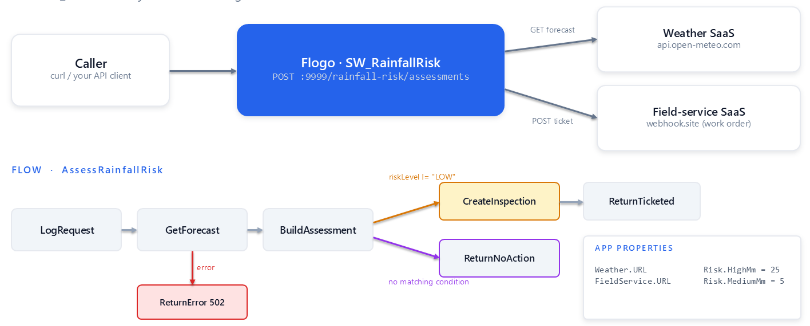

# Lab 1 — Rainfall Risk API (API integration & mediation)



The API contract is [`specs/rainfall-risk-api.openapi.json`](specs/rainfall-risk-api.openapi.json) (OpenAPI 3.0):

| | |
|---|---|
| Endpoint | `POST http://localhost:9999/rainfall-risk/assessments` |
| Request | `{"siteId":"PS-102","siteName":"Parramatta Sewage Pumping Station SP0102","latitude":-33.815,"longitude":151.001,"forecastDays":3}` (`forecastDays` 1–7) |
| Response 200 | `{"siteId":"PS-102","siteName":"…","riskLevel":"MEDIUM","totalRainfallMm":12.0,"inspectionRequested":true,"message":"…"}` (`riskLevel` LOW / MEDIUM / HIGH / UNKNOWN) |

There are two apps for this contract:

| App | What it does | Who builds it |
|---|---|---|
| **`SW_RainfallRisk_FromSpec`** (hands-on) | The contract with simple mock logic (4 mm of rain per forecast day) | **You, by hand — part A** |
| **`SW_RainfallRisk`** (full solution) | Calls the Open-Meteo weather API, rates the risk, raises an inspection work order in a field-service SaaS (webhook.site), 502 error branch | Presenter demo; **you run it — part B** |

---

## Part A — build the API from the spec, by hand (~15 min)

Fast track: [`../solutions/Lab1_SW_RainfallRisk_FromSpec.flogo`](../solutions/Lab1_SW_RainfallRisk_FromSpec.flogo)

1. **Explorer** → right-click the `lab1` folder → **Create New Flogo App** → name it `SW_RainfallRisk_FromSpec`.
2. **FLOWS** tab → **Create** → name `AssessRainfallRisk` → **Create**.
3. In the triggers area on the left, add a **ReceiveHTTPMessage** trigger (REST):
   - **Method** = `POST`, **Resource path** = `/rainfall-risk/assessments`
   - **Request Schema** — paste the request sample from the spec (Flogo infers the JSON schema from a sample):
     ```json
     {"siteId":"PS-102","siteName":"Parramatta Sewage Pumping Station SP0102","latitude":-33.815,"longitude":151.001,"forecastDays":3}
     ```
   - **Trigger Settings** → **Port** = `9999`
   - **Reply Settings** → **Response Schema** — paste the response sample:
     ```json
     {"siteId":"PS-102","siteName":"text","totalRainfallMm":12.5,"riskLevel":"LOW","inspectionRequested":false,"message":"text"}
     ```
   - Check **Map to Flow Inputs** (`body`, `headers` from the trigger) and **Map from Flow Outputs** (`code`, `data`).
     Save.
4. **+** after the trigger → **General → Log Message**, rename `LogRequest`, **message**:
   ```
   string.concat("Rainfall risk request for site ", $flow.body.siteId, " - ", $flow.body.siteName)
   ```
5. **+** → **General → Mapper**, rename `MockAssessment`. **Input Settings** → paste this sample:
   ```json
   {"totalRainfallMm":12.5,"riskLevel":"LOW","inspectionRequested":false,"message":"text"}
   ```
   **Input** tab → map:

   | Field | Expression |
   |---|---|
   | `totalRainfallMm` | `coerce.toFloat64($flow.body.forecastDays) * 4.0` |
   | `riskLevel` | `coerce.toFloat64($flow.body.forecastDays) * 4.0 >= 25 ? "HIGH" : (coerce.toFloat64($flow.body.forecastDays) * 4.0 >= 5 ? "MEDIUM" : "LOW")` |
   | `inspectionRequested` | `coerce.toFloat64($flow.body.forecastDays) * 4.0 >= 5` |
   | `message` | `string.concat("Mock assessment: ", coerce.toString($flow.body.forecastDays), " forecast days x 4 mm per day (no weather API called yet)")` |

6. **+** → **Return**, map `code` = `200` and `data`:
   `siteId` = `$flow.body.siteId`, `siteName` = `$flow.body.siteName`, and the other four fields from
   `$activity[MockAssessment].output.<field>`.
7. Save → **Flogo** app view → `SW_RainfallRisk_FromSpec` → **Run as Executable**.

### Test part A (terminal)

```bash
cd ~/FlogoLab/lab1
for d in 1 3 7; do
  curl -s -X POST http://localhost:9999/rainfall-risk/assessments -H "Content-Type: application/json" \
    -d "{\"siteId\":\"PS-102\",\"siteName\":\"Parramatta Sewage Pumping Station SP0102\",\"latitude\":-33.815,\"longitude\":151.001,\"forecastDays\":$d}"
  echo
done
```

Expected: `forecastDays` 1 → `LOW` (4 mm), 3 → `MEDIUM` (12 mm, `inspectionRequested: true`), 7 → `HIGH` (28 mm).
**Stop the app** before part B (both use port 9999).

---

## Part B — run the full solution

1. Open https://webhook.site in Firefox and copy **Your unique URL** (your field-service SaaS for today).
2. Open [`../solutions/Lab1_SW_RainfallRisk.flogo`](../solutions/Lab1_SW_RainfallRisk.flogo). **APP PROPERTIES** →
   `FieldService.URL` = your webhook.site URL. Save → **Run as Executable** (port 9999).
3. Call it — the request bodies are in this folder:
   ```bash
   cd ~/FlogoLab/lab1
   curl -s -X POST http://localhost:9999/rainfall-risk/assessments -H "Content-Type: application/json" --data @parramatta-1day.json; echo
   curl -s -X POST http://localhost:9999/rainfall-risk/assessments -H "Content-Type: application/json" --data @parramatta-3day.json; echo
   curl -s -X POST http://localhost:9999/rainfall-risk/assessments -H "Content-Type: application/json" --data @parramatta-7day.json; echo
   ```
   Or all three with checks: `bash sample-requests.sh`
4. Watch webhook.site: a work order arrives for every **MEDIUM** or **HIGH** result. The weather is live, so the
   risk depends on the real forecast. Dry week? **APP PROPERTIES** → `Risk.MediumMm` = `0`, run again → ticket.
5. Error branch: set `Weather.URL` = `https://api.open-meteo.invalid/v1/forecast`, run, call again → **HTTP 502**
   `"Weather service unavailable: …"`. Set it back afterwards.
6. **Keep it running** — Lab 3 calls it.

Presenter demo for this lab (API spec → REST service with FDA `create-api-skeleton`): [`presenter-demo.md`](presenter-demo.md).
