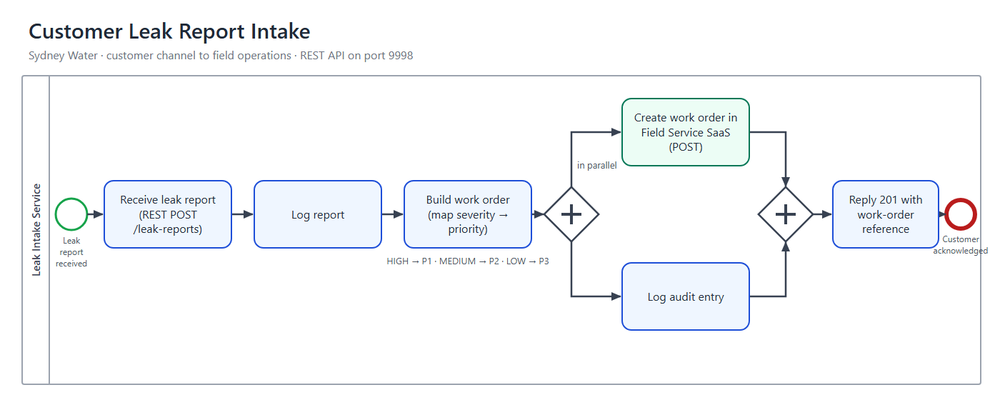
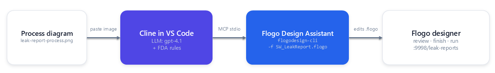

# Lab 2 — Leak Report Intake, from a process diagram (AI-assisted development)

The presenter builds this app live from a process diagram with **Cline + the Flogo Design Assistant (FDA)**; you run
the finished solution.

**The diagram:** [`leak-report-process.png`](leak-report-process.png)



**How it was built:** Cline (gpt-4.1) reads the picture and calls FDA's MCP tools to create the trigger, five
activities and the parallel paths in ~30 s; the developer finishes schemas and mappings in the designer.
Prompts: [`prompts.md`](prompts.md). Architecture:



## The API

Contract: [`specs/leak-report-api.openapi.json`](specs/leak-report-api.openapi.json) (OpenAPI 3.0)

| | |
|---|---|
| Endpoint | `POST http://localhost:9998/leak-reports` |
| Request | `{"reportId":"LR-1001","address":"12 Church St","suburb":"Parramatta","description":"Water bubbling up through the footpath","severity":"HIGH"}` |
| Response 201 | `{"reportId":"LR-1001","workOrderRef":"WO-LR-1001","priority":"P1","status":"RECEIVED"}` |
| Rules | severity `HIGH` → `P1`, `MEDIUM` → `P2`, anything else → `P3`; `workOrderRef` = `"WO-"` + reportId |

Flow: receive → log → build work order (severity → priority) → **in parallel** create the work order in the
field-service SaaS (`FieldService.URL`) and write an audit log → reply 201.

## Run the solution

1. Open [`../solutions/Lab2_SW_LeakReport.flogo`](../solutions/Lab2_SW_LeakReport.flogo). Optional: **APP PROPERTIES**
   → `FieldService.URL` = your webhook.site URL from Lab 1 (default `https://postman-echo.com/post`).
2. Save → **Flogo** app view → **Run as Executable** (port 9998).
3. Test (terminal):
   ```bash
   curl -s -i -X POST http://localhost:9998/leak-reports -H "Content-Type: application/json" \
     -d '{"reportId":"LR-1001","address":"12 Church St","suburb":"Parramatta","description":"Water bubbling up through the footpath","severity":"HIGH"}'
   ```
   Expected: `HTTP/1.1 201` and `{"priority":"P1","reportId":"LR-1001","status":"RECEIVED","workOrderRef":"WO-LR-1001"}`.
   All three severities with checks: `cd ~/FlogoLab/lab2 && bash test-leak.sh`
4. **Keep it running** — Lab 3 calls it.

Want to build it yourself with the AI? Section "Prompts" in [`prompts.md`](prompts.md) (Cline + FDA MCP server), or
[`prompts-fda-skills.md`](prompts-fda-skills.md) (Cline + FDA skills).
