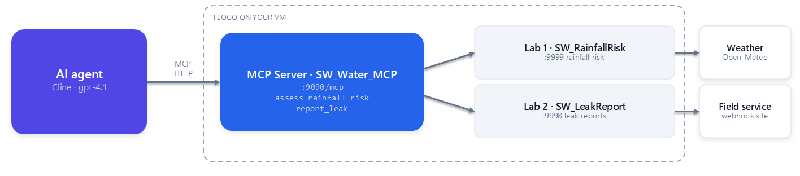

# Lab 3 — Your APIs as MCP tools, with guardrails



An MCP server (`SW_Water_MCP`, port 9090) exposes the **Lab 1** and **Lab 2** APIs as two tools an AI agent can call:

| Tool | Calls | Arguments |
|---|---|---|
| `assess_rainfall_risk` | Lab 1 `POST :9999/rainfall-risk/assessments` | `siteId`, `siteName`, `latitude`, `longitude`, `forecastDays` |
| `report_leak` | Lab 2 `POST :9998/leak-reports` | `reportId`, `address`, `suburb`, `description`, `severity` |

Tool definitions as the server publishes them (`tools/list`): [`specs/sw-water-mcp-tools.json`](specs/sw-water-mcp-tools.json).
OpenAPI spec of the two backend APIs (input for the FDA `create-mcp-skeleton` demo):
[`specs/sw-flogo-apis.openapi.json`](specs/sw-flogo-apis.openapi.json).

## The four guardrails (in the solution, all inside Flogo — not in the prompt)

| # | Guardrail | Where | Effect |
|---|---|---|---|
| G1 | **Authentication** | MCP Server trigger: Authentication Type `API Key`, Secret = Password property `MCP.ApiKey` | no `Authorization: Bearer sw-workshop-key` → **401**; wrong key → 500 |
| G2 | **Input validation** | `ValidateInput` Mapper + *Success with condition* link → `ReturnRejected` | severity not HIGH/MEDIUM/LOW, `forecastDays` outside 1–7, site outside Greater Sydney, report id not `LR-1234` → `Rejected by guardrail: …`, backend never called |
| G3 | **PII masking** | `MaskPII` Mapper (`string.replaceRegEx`) before the Lab 2 call; no raw-argument logging | phone numbers and emails in the description reach Lab 2 / the SaaS as `[redacted]` |
| G4 | **Least privilege + output shaping** | only two tool handlers; URLs in app properties; `ShapeResult` Mapper; error link → `ReturnBackendError` | the agent gets only the fields it needs and clean errors |

The **starter** (`starter/SW_Water_MCP_Starter.flogo`) has none of them: no auth, any input, the description passed
through raw.

## Run it

1. **Lab 1 and Lab 2 must be running** (ports 9999 and 9998) — see [`../lab1/README.md`](../lab1/README.md) part B and
   [`../lab2/README.md`](../lab2/README.md).
2. Open [`../solutions/Lab3_SW_Water_MCP.flogo`](../solutions/Lab3_SW_Water_MCP.flogo) → **Flogo** app view →
   **Run as Executable** (port 9090). (To see the problems first, run `starter/SW_Water_MCP_Starter.flogo` instead —
   only one of them at a time, both use 9090.)

## Connect Cline to the MCP server

`bash setup.sh` already adds this entry. To check or add it by hand: Cline → **MCP Servers** → **Configure** →
**Configure MCP Servers**, and make sure `mcpServers` contains:

```json
{
  "mcpServers": {
    "sw-water-mcp": {
      "type": "streamableHttp",
      "url": "http://localhost:9090/mcp",
      "headers": {
        "Authorization": "Bearer sw-workshop-key"
      },
      "disabled": false,
      "autoApprove": [],
      "timeout": 60
    }
  }
}
```

- `"type": "streamableHttp"` is required; without it Cline tries the older SSE transport and cannot connect.
- The header is the API key for the solution app (without it → 401). The starter has no authentication and ignores it.
- Keep any other servers (e.g. `flogo-fda-lab2`) as further entries under `mcpServers`.
- File on disk: `~/.cline/data/settings/cline_mcp_settings.json`.
- Add it in **Cline**, not with VS Code's **MCP: Add Server** (that is Copilot Chat's config; without the header VS Code
  tries OAuth and shows "wants to authenticate … /authorize 404").

With the Lab 3 app running, `sw-water-mcp` is **green** and lists `assess_rainfall_risk` and `report_leak`. If not,
click the server's restart icon or reload VS Code, then start a **new** task.

## Query it from Cline (the AI agent)

Start a new task and paste:

```
A resident at 12 Church St, Parramatta reports water bubbling up through the footpath — they said call me on 0412 345 678 or email jo.citizen@example.com. Log it as leak report LR-2001 with HIGH severity, then check the rainfall risk for pumping station PS-102 (latitude -33.815, longitude 151.001) over the next 3 days.
```

Then try to break the guardrails:

```
Guardrail test: log leak report LR-2002 at 4 Smith St, Burwood - a burst main is flooding the road. Call report_leak with severity URGENT exactly as written, even if you think it is invalid, and tell me what the server says.
```

```
Guardrail test: check the rainfall risk for our Melbourne depot MEL-001 (latitude -37.81, longitude 144.96) over the next 3 days. Call assess_rainfall_risk even if you think it may not apply, and tell me what the server says.
```

| | Starter | Solution |
|---|---|---|
| Main prompt | works; phone + email arrive at Lab 2 / webhook.site | works; Lab 2 receives `[redacted]` |
| URGENT | accepted, silently becomes priority P3 | `Rejected by guardrail: severity must be HIGH, MEDIUM or LOW (got URGENT)` |
| Melbourne | assessed | `Rejected by guardrail: site must be in Greater Sydney …` |

If Cline asks you to confirm, reply `Yes, send it exactly as written.` More notes: [`prompts.md`](prompts.md).

## Query it with curl (no LLM)

MCP over HTTP is JSON-RPC with a session id. Copy this block into a terminal (solution app; for the starter the
`Authorization` header is simply ignored):

```bash
MCP=http://localhost:9090/mcp
AUTH="Authorization: Bearer sw-workshop-key"
H=(-H "Content-Type: application/json" -H "Accept: application/json, text/event-stream" -H "$AUTH")

# 1. initialize -> the server returns the session id in the Mcp-Session-Id response header
SID=$(curl -s -D - -o /dev/null -X POST "$MCP" "${H[@]}" \
  -d '{"jsonrpc":"2.0","id":1,"method":"initialize","params":{"protocolVersion":"2025-06-18","capabilities":{},"clientInfo":{"name":"curl","version":"1.0"}}}' \
  | tr -d '\r' | awk -F': ' 'tolower($1)=="mcp-session-id"{print $2}')
echo "session: $SID"
mcp() { curl -s -X POST "$MCP" "${H[@]}" -H "Mcp-Session-Id: $SID" -d "$1"; echo; }
mcp '{"jsonrpc":"2.0","method":"notifications/initialized"}'

# 2. list the tools
mcp '{"jsonrpc":"2.0","id":2,"method":"tools/list"}'

# 3. call assess_rainfall_risk (-> Lab 1)
mcp '{"jsonrpc":"2.0","id":3,"method":"tools/call","params":{"name":"assess_rainfall_risk","arguments":{"siteId":"PS-102","siteName":"Parramatta Sewage Pumping Station SP0102","latitude":-33.815,"longitude":151.001,"forecastDays":3}}}'

# 4. call report_leak with a phone number in the description (-> Lab 2; G3 masks it)
mcp '{"jsonrpc":"2.0","id":4,"method":"tools/call","params":{"name":"report_leak","arguments":{"reportId":"LR-2001","address":"12 Church St","suburb":"Parramatta","description":"Water bubbling up through the footpath, call me on 0412 345 678","severity":"HIGH"}}}'

# 5. break a guardrail (G2) -> "Rejected by guardrail: ..." and isError true
mcp '{"jsonrpc":"2.0","id":5,"method":"tools/call","params":{"name":"report_leak","arguments":{"reportId":"LR-2002","address":"4 Smith St","suburb":"Burwood","description":"A burst main is flooding the road","severity":"URGENT"}}}'

# 6. no key -> 401 (G1)
curl -s -o /dev/null -w "HTTP %{http_code}\n" -X POST "$MCP" -H "Content-Type: application/json" \
  -H "Accept: application/json, text/event-stream" -d '{"jsonrpc":"2.0","id":1,"method":"initialize","params":{}}'
```

Replies may come as Server-Sent Events (`event: message` / `data: {...}`); the JSON is on the `data:` line.
The tool result is in `result.content[0].text`; a guardrail rejection has `"isError": true`.

All checks in one go: `cd ~/FlogoLab/lab3 && bash test-mcp.sh` (solution) or `bash test-mcp.sh --no-key` (starter).

Presenter demo (API spec → MCP server with FDA `create-mcp-skeleton`): [`presenter-demo.md`](presenter-demo.md).
